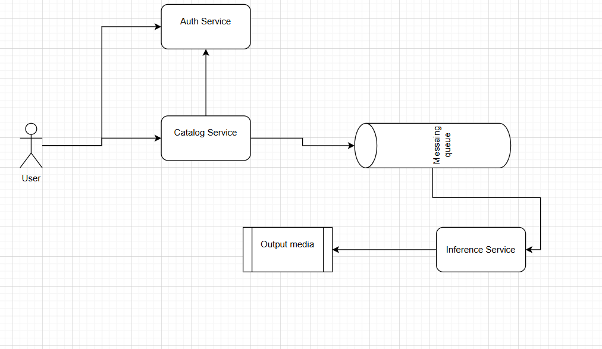

# GenStore

A dummy appliction that allows user to generate videos/images and other cool stuff.
(It just mimics the behavior of generation , its doesn't do generation on its own)
It an application developed to learn about the implementation of best devops practices and create a production ready setup that Devops and SRE's 
use.

## Architecture

## Componenets
- UI (Nginx service that services static/dynamic content)
- Auth Service (Manages the authentication mechanism and authorization to some extent.)
- Catalog Service (A backend service allowing users to list products and place orders.)
- Inference Service ( Generates the product based on the order )
- Messaging Queue (Rabbitmq) (To queue user orders)

***NOTE***: **You can find more documentation inside each folder. For now, everything is hardcoded to keep it simple as we are more concerned with operation level practices rather than software development practices itself.**

## Future Evolutions / Improvements / Advice
Keeping it simple, only 1 repository is used to bootstrap all the applicaiton repositories. In real world, it is better to have a seperate Code repository for each app, each having its own set of pipelines.

